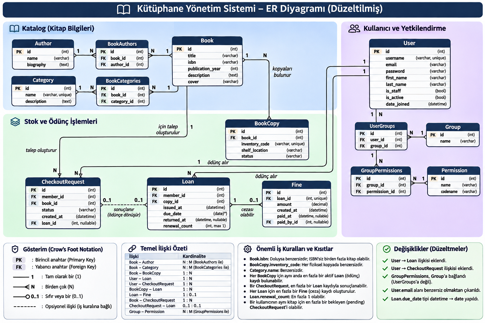
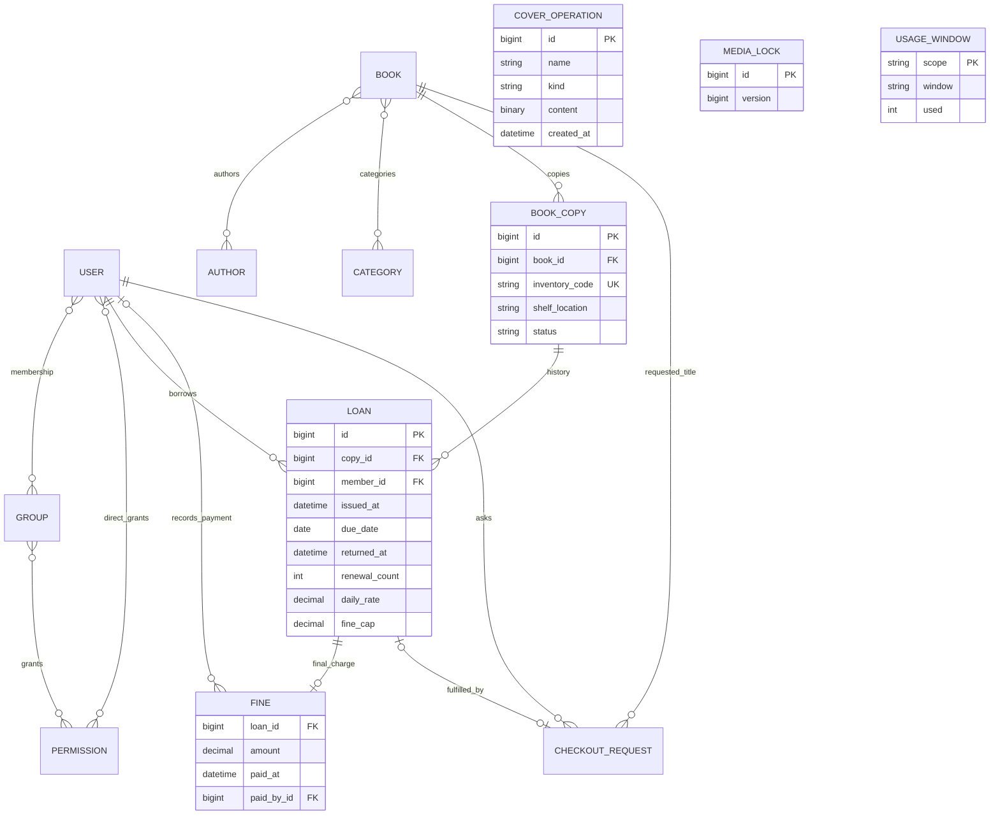

## Görsel ER Diyagramı

*Görsel, sistemin temel varlıklarını ve ilişkilerini özetler. Ayrıntılı teknik veri modeli aşağıdadır.*

# Uygulamanın veri modeli

`UsageWindow` üye/dakika, üye/gün ve uygulama/gün sayaçlarını tutar. Katalog kitabı ile model önerisi arasında kalıcı ilişki kurulmaz. Diyagram uygulamanın alan ilişkilerini gösterir; Django'nun oturum ve admin günlük tabloları ayrıca standart migration'larla oluşturulur.

Kapak işlem kuyruğunun `name` alanı dosya adını taşır. İlişki Book.cover değeri üzerinden uygulamada yönetilir. MediaLock yayın, silme ve yedekleme sırasında ortak kilit sağlar.
